<a href="docs/design-system.md"><picture><source media="(prefers-color-scheme: dark)" srcset="docs/images/readme/hero-dark.png">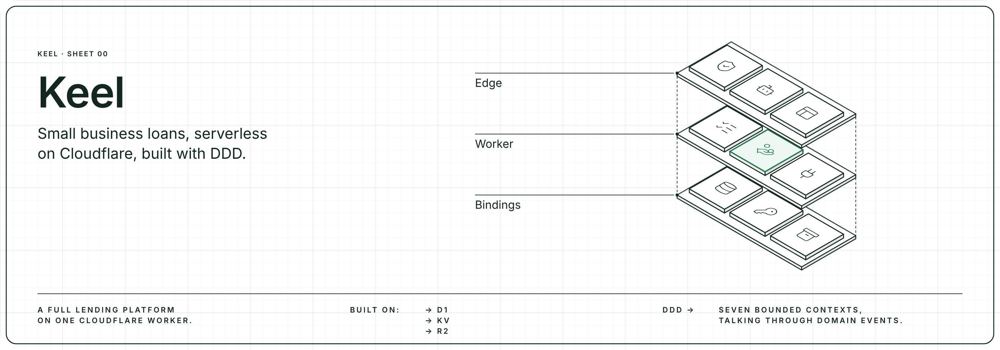</picture></a>

<p align="center">
  <a href="https://developers.cloudflare.com/workers/"><picture><source media="(prefers-color-scheme: dark)" srcset="docs/images/readme/pill-cloudflare-workers-dark.png"></picture></a>
  <a href="https://developers.cloudflare.com/d1/"><picture><source media="(prefers-color-scheme: dark)" srcset="docs/images/readme/pill-d1-dark.png">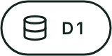</picture></a>
  <a href="https://developers.cloudflare.com/kv/"><picture><source media="(prefers-color-scheme: dark)" srcset="docs/images/readme/pill-kv-dark.png"></picture></a>
  <a href="https://developers.cloudflare.com/r2/"><picture><source media="(prefers-color-scheme: dark)" srcset="docs/images/readme/pill-r2-dark.png"></picture></a>
  <a href="https://developers.cloudflare.com/turnstile/"><picture><source media="(prefers-color-scheme: dark)" srcset="docs/images/readme/pill-turnstile-dark.png"></picture></a>
  <a href="https://developers.cloudflare.com/workers/configuration/cron-triggers/"><picture><source media="(prefers-color-scheme: dark)" srcset="docs/images/readme/pill-cron-triggers-dark.png"></picture></a>
</p>
<p align="center">
  <a href="https://www.typescriptlang.org"><picture><source media="(prefers-color-scheme: dark)" srcset="docs/images/readme/pill-typescript-dark.png"></picture></a>
  <a href="https://hono.dev"><picture><source media="(prefers-color-scheme: dark)" srcset="docs/images/readme/pill-hono-dark.png"></picture></a>
  <a href="api/openapi.json"><picture><source media="(prefers-color-scheme: dark)" srcset="docs/images/readme/pill-openapi-dark.png">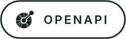</picture></a>
  <a href="https://vitest.dev"><picture><source media="(prefers-color-scheme: dark)" srcset="docs/images/readme/pill-vitest-dark.png"></picture></a>
  <a href="#why-domain-driven-design"><picture><source media="(prefers-color-scheme: dark)" srcset="docs/images/readme/pill-domain-driven-design-dark.png"></picture></a>
</p>
<p align="center">
  <a href="https://react.dev"><picture><source media="(prefers-color-scheme: dark)" srcset="docs/images/readme/pill-react-dark.png"></picture></a>
  <a href="https://vite.dev"><picture><source media="(prefers-color-scheme: dark)" srcset="docs/images/readme/pill-vite-dark.png"></picture></a>
  <a href="https://tailwindcss.com"><picture><source media="(prefers-color-scheme: dark)" srcset="docs/images/readme/pill-tailwind-css-dark.png"></picture></a>
  <a href="https://gsap.com"><picture><source media="(prefers-color-scheme: dark)" srcset="docs/images/readme/pill-gsap-dark.png"></picture></a>
  <a href="docs/design-system.md"><picture><source media="(prefers-color-scheme: dark)" srcset="docs/images/readme/pill-design-system-dark.png"></picture></a>
</p>
<p align="center">
  <a href="https://developer.paypal.com"><picture><source media="(prefers-color-scheme: dark)" srcset="docs/images/readme/pill-paypal-dark.png"></picture></a>
  <a href="https://plaid.com/docs/"><picture><source media="(prefers-color-scheme: dark)" srcset="docs/images/readme/pill-plaid-dark.png"></picture></a>
  <a href="https://didit.me"><picture><source media="(prefers-color-scheme: dark)" srcset="docs/images/readme/pill-didit-dark.png"></picture></a>
  <a href="https://resend.com"><picture><source media="(prefers-color-scheme: dark)" srcset="docs/images/readme/pill-resend-dark.png"></picture></a>
</p>

<br>

## What the system does

[Keel](https://microloans-platform.yasser-dalali-personal.workers.dev/) lends small amounts of money to small businesses: shops, workshops and market stalls. Loans go from $500 to $10,000. Keel does the work that a lender normally does by hand. It checks who the borrower is, it looks at their bank account, and it decides if the risk is acceptable. A loan officer then approves or declines the application. After approval, the system makes the repayment schedule, takes each payment and sends a receipt.

Four actors use the system. A **visitor** creates an account and logs in. A **borrower** completes a profile, verifies their identity, links a bank, applies for a loan and repays it. An **officer** reviews applications and decides. A **scheduler** runs once a day and marks late payments as overdue. Three outside systems help: Didit checks identity, Plaid reads the bank account and PayPal moves the money.

<p align="center">
  <a href="https://microloans-platform.yasser-dalali-personal.workers.dev/"><picture><source media="(prefers-color-scheme: dark)" srcset="docs/images/screens/landing-dark.png">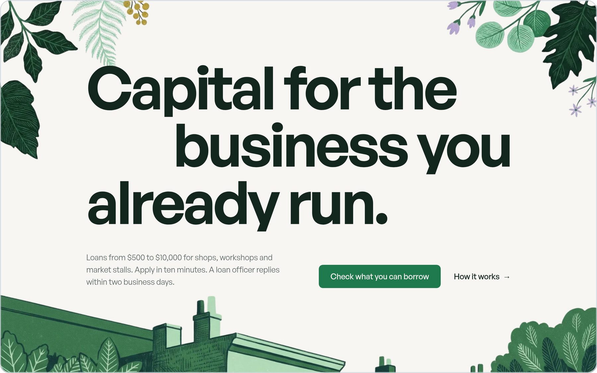</picture></a>
</p>
<p align="center">
  <picture><source media="(prefers-color-scheme: dark)" srcset="docs/images/screens/signup-dark.png">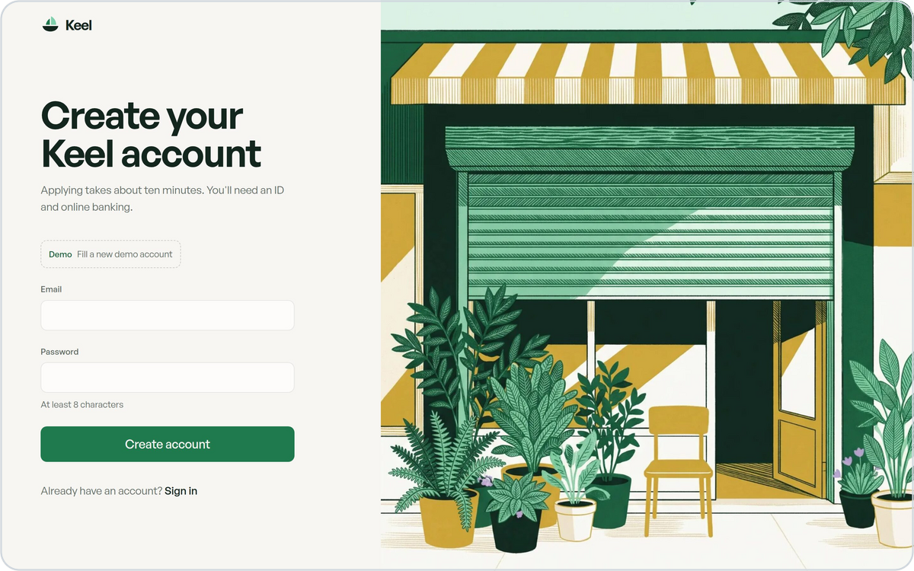</picture>
  <picture><source media="(prefers-color-scheme: dark)" srcset="docs/images/screens/system-dark.png">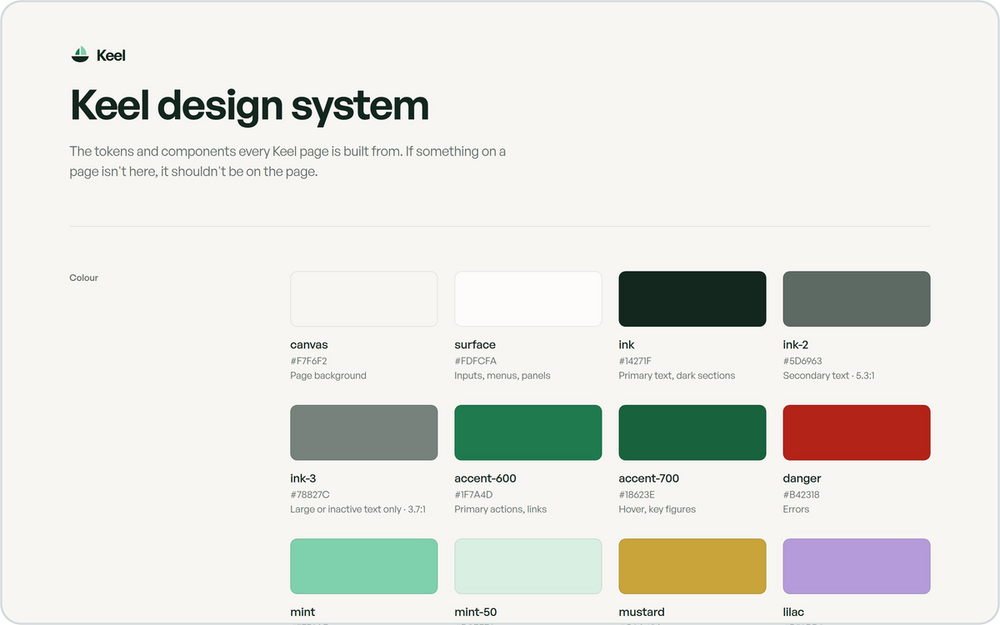</picture>
</p>

The live app runs at **[microloans-platform.yasser-dalali-personal.workers.dev](https://microloans-platform.yasser-dalali-personal.workers.dev/)** in demo mode. Demo mode adds buttons that fill the forms and skip the provider steps, so you can try the whole flow without real documents.

<p align="center">
  <a href="docs/images/uml-usecases.png"><picture><source media="(prefers-color-scheme: dark)" srcset="docs/images/uml-usecases-dark.png">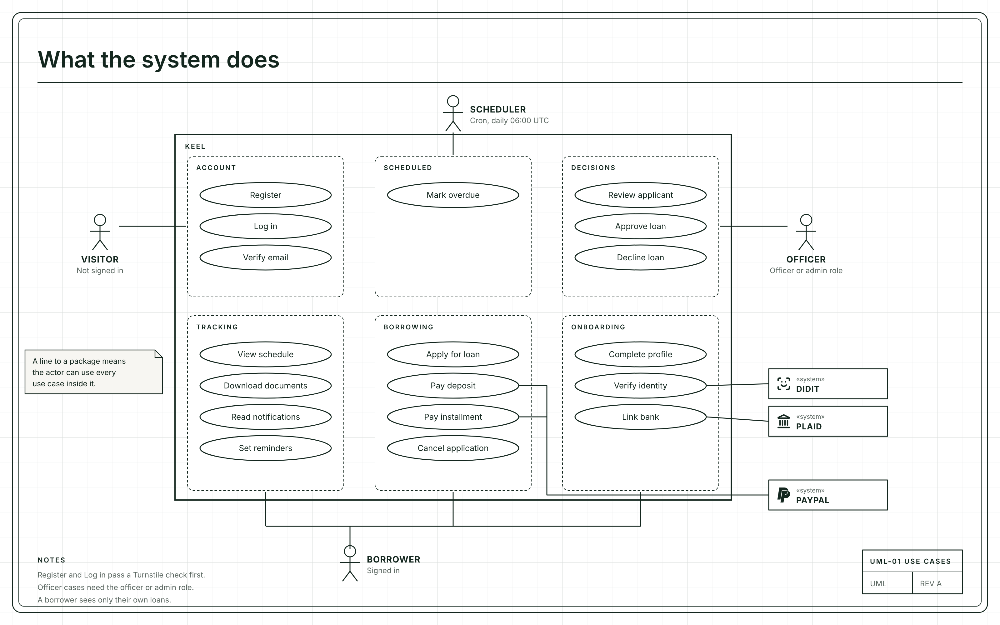</picture></a>
</p>

The diagram groups the use cases by purpose. A line to a group means the actor can use every case inside it. A borrower sees only their own loans. The officer cases need the officer or admin role. Register and log in pass a Turnstile bot check first.

## What this project focuses on

This is a personal project. Its aim is to show how to build a real, complete product on serverless infrastructure, with a design that stays easy to change. These are the areas it focuses on:

- **Serverless cloud infrastructure.** The platform runs on one Cloudflare Worker. The same design also suits other serverless functions: no long-running server, storage through managed services, and billing by use.
- **Domain-Driven Design.** The business rules live in a domain model, in the words of the business. They do not live in routes or in SQL.
- **Loose coupling.** The parts of the system talk through ports and domain events, not through direct calls into each other's code. Each part can change without breaking the others.
- **Clean, typed code.** The code is strict TypeScript. Money is a value object in whole cents. Errors are named domain errors. Each use case is one small class.
- **API practice.** The API returns clear status codes and named errors, and an OpenAPI document ([`api/openapi.json`](api/openapi.json)) describes it. Webhooks are verified and safe to receive twice.
- **A friendly interface.** The web app (Keel) gives clear steps, plain words and fast feedback. Every animation has a reduced-motion path.

These areas are **not** the focus, and the project keeps them small on purpose:

- **Real money and compliance.** Providers run in sandbox mode. There is no real disbursement, no licence work and no legal review.
- **Scale and multi-region data.** One D1 database is enough here. Sharding and replication are out of scope.
- **Collections and defaults.** The model has a `defaulted` status, but no process sets it yet.
- **A full admin back office.** Officers get a review queue, not a complete operations tool.

<br>

## The stack

<p align="center">
  <a href="docs/images/cf-stack.png"><picture><source media="(prefers-color-scheme: dark)" srcset="docs/images/cf-stack-dark.png"></picture></a>
</p>

One Cloudflare Worker runs the whole platform. It serves the API through [Hono](https://hono.dev) and the built React frontend as static assets. Requests to `/api`, `/docs` and `/openapi.json` go to Hono. All other paths return the single-page app. The platform deploys as one unit with one command, `npm run deploy`. No machine stays on between requests, so the cost follows the use: requests, database reads and writes, and stored bytes.

The Worker reaches its storage through bindings that [`wrangler.toml`](wrangler.toml) declares. A binding is a typed handle that Cloudflare gives to the code, so the code never holds a connection string. **D1** is the relational database (SQLite). It holds users, profiles, loans, installments and the payment ledger. **KV** holds short-lived keys: the token blacklist for logout, a throttle for verification emails and dedup keys for Didit webhooks. **R2** stores the PDF documents, such as loan agreements, receipts and statements.

Cloudflare's edge terminates TLS and absorbs DDoS traffic before the Worker runs. Turnstile checks each register and log-in request, and the check fails closed: if the check cannot run, the request stops. Sessions use HS256 JSON Web Tokens with three roles: borrower, officer and admin. Personal data in the profile, and the Plaid access token, are encrypted with AES-GCM before they reach D1. A cron trigger runs every day at 06:00 UTC and marks late installments as overdue.

The frontend is React 19 with Vite 8 and Tailwind CSS v4. The tests run in Vitest inside the real Workers runtime (Miniflare), with real D1, KV and R2 bindings, not mocks.

<br>

## Why Domain-Driven Design

A loan has many rules. An application needs a verified email, an approved identity check and a linked bank. A large loan needs a deposit before approval. A borrower can cancel only while the loan is pending and before any deposit is paid. The schedule must add up to the exact total, to the cent. If these rules live in routes and SQL, they spread across many files. Then a change to one rule can break another, and nobody can see all the rules in one place.

Domain-Driven Design (DDD) puts the rules in one place: a model of the business, written in the business's own words. The model is plain TypeScript. It does not know about HTTP, about D1 or about PayPal. So you can test each rule in milliseconds, and you can read the code as a description of how lending works.

DDD also splits a large system into **bounded contexts**. Each context owns one part of the business and its own words. In this project "user" means an account in Identity, and "applicant" means a person who asks for a loan in Lending. The two words do not mix, and each context can change its inside without asking the others.

<p align="center">
  <a href="docs/images/cf-domain-3d.png"><picture><source media="(prefers-color-scheme: dark)" srcset="docs/images/cf-domain-3d-dark.png"></picture></a>
</p>

The system has seven bounded contexts. **Identity** owns user accounts and email verification. **Borrower** owns the profile, the identity check and the bank link. **Lending** is the core domain: it owns the loan and its rules. **Payments** moves money and keeps the ledger. **Documents** makes the PDFs. **Communication** sends notifications and email. **Reporting** builds the read models for the dashboard and keeps the reminder settings.

The contexts are loosely coupled in two ways. First, when a context needs facts from another, it declares a **port** in its own words. Lending, for example, asks one question through `ApplicantGateway`. The composition root in `app/wiring/` connects that port to Identity and Borrower, so Lending never learns how they store their data. Second, changes travel as **domain events**. When a loan is approved, Lending does not call Payments, Documents and Communication. It records the event `loan-approved`, and each of them reacts on its own. The matrix on the sheet shows which context reacts to each of the nine events.

### The event bus

<p align="center">
  <a href="docs/images/uml-eventbus.png"><picture><source media="(prefers-color-scheme: dark)" srcset="docs/images/uml-eventbus-dark.png">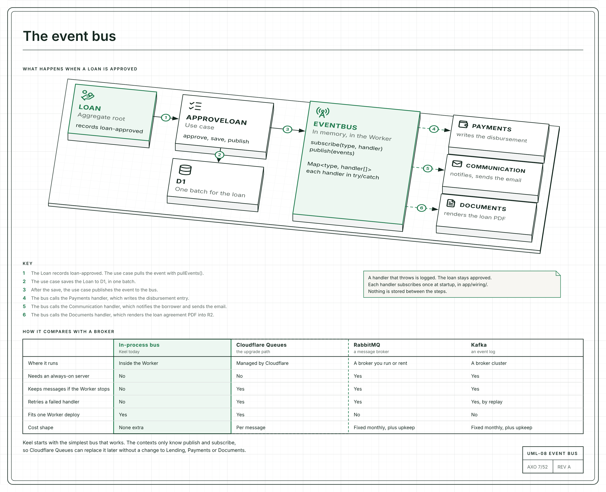</picture></a>
</p>

The event bus is the post office between the contexts. A context can **publish** an event, such as `loan-approved`. Other contexts can **subscribe** to that event, and the bus calls their handlers. The publisher does not know who listens. The code is about 25 lines in [`api/src/shared/events.ts`](api/src/shared/events.ts). It is a `Map` of event types to lists of handlers, and it lives in memory, inside the Worker.

Keel does not use Kafka or RabbitMQ, for four reasons. First, both are servers that must stay on all day, and Keel has no machine that runs between requests. Second, a consumer needs a long-running process, and a Worker lives for one request. Third, Keel produces a handful of events per loan, and Kafka is built for thousands per second. Fourth, all seven contexts already run in one process, so a network hop between them adds cost and gives nothing back.

The price is durability. If the Worker stops after the save and before a handler runs, that reaction is lost, and nothing retries a handler that fails. For an email or a PDF this is acceptable. For money it is not, so the ledger protects itself: it records each provider reference once, and a repeat does no harm. When the project needs stronger guarantees, [Cloudflare Queues](https://developers.cloudflare.com/queues/) is the next step. The contexts only know `publish` and `subscribe`, so the bus can change without any change to Lending, Payments or Documents.

### How the code is organised

<p align="center">
  <a href="docs/images/uml-packages.png"><picture><source media="(prefers-color-scheme: dark)" srcset="docs/images/uml-packages-dark.png">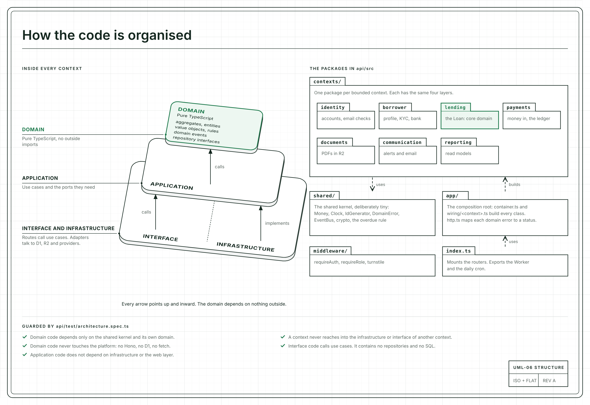</picture></a>
</p>

Each context has the same four layers, and the dependencies point inward only. The **domain** layer is pure TypeScript and imports nothing from Hono, D1 or another context. The **application** layer holds the use cases. A use case loads an aggregate, calls one method, saves it and publishes its events. It contains no business rules. The **infrastructure** layer talks to D1, R2 and the providers, and provider data never leaves it. The **interface** layer is the HTTP edge. It contains no SQL and no rules. It maps each named domain error to a status code in one place, [`app/http.ts`](api/src/app/http.ts).

A test protects this structure. [`api/test/architecture.spec.ts`](api/test/architecture.spec.ts) fails when a domain layer imports Hono or D1, when a context reaches into the infrastructure of another context, or when a router contains SQL. So the structure does not decay over time.

<br>

## Where the data lives

<p align="center">
  <a href="docs/images/uml-erd.png"><picture><source media="(prefers-color-scheme: dark)" srcset="docs/images/uml-erd-dark.png">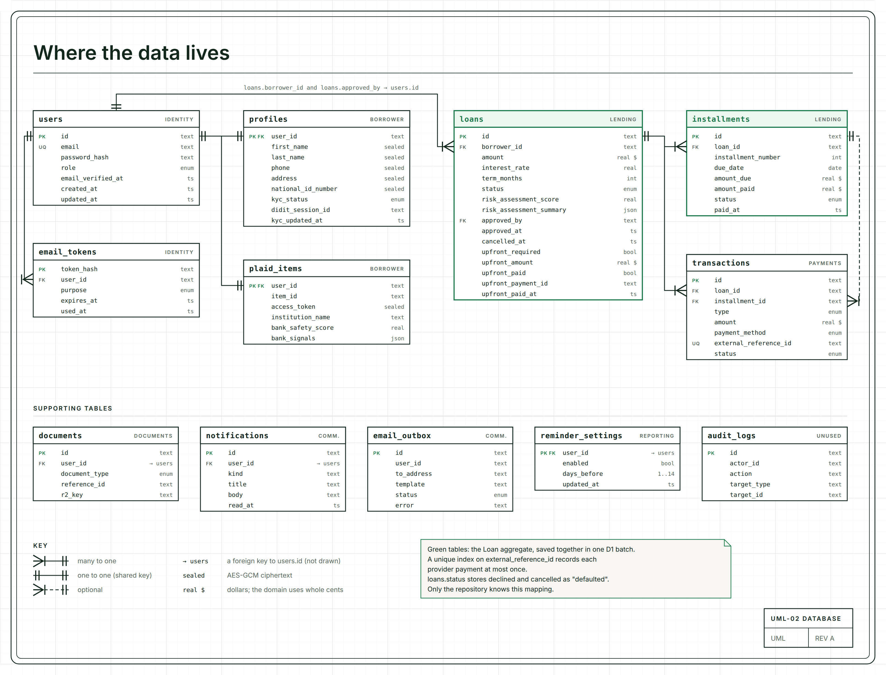</picture></a>
</p>

D1 holds twelve tables, and each table belongs to one context. The context name sits in the corner of each table. The two green tables, `loans` and `installments`, hold the Loan aggregate. The repository writes them together in one batch, so a loan and its installments never disagree. If another request changed the loan first, the save fails and overwrites nothing.

Some columns are marked `sealed`. They hold AES-GCM ciphertext: the name, phone, address and national ID in `profiles`, and the Plaid access token. The repository seals each value before the write and opens it after the read, so the database never sees plain personal data. Amounts are stored in dollars, and the domain converts them to whole cents in a `Money` value object. A unique index on `transactions.external_reference_id` makes sure that the ledger records each provider payment at most once.

<br>

## Feature: applying for a loan

<p align="center">
  <a href="docs/images/cf-lending-3d.png"><picture><source media="(prefers-color-scheme: dark)" srcset="docs/images/cf-lending-3d-dark.png"></picture></a>
</p>

The Lending context is the heart of the system. The blueprint above shows its three layers. The use cases sit on the left, the domain model in the middle and the adapters on the right. The aggregate boundary, the dashed green line, marks what the Loan owns. The status machine on the left of the sheet shows each allowed change of status.

<p align="center">
  <a href="docs/images/uml-lending-classes.png"><picture><source media="(prefers-color-scheme: dark)" srcset="docs/images/uml-lending-classes-dark.png">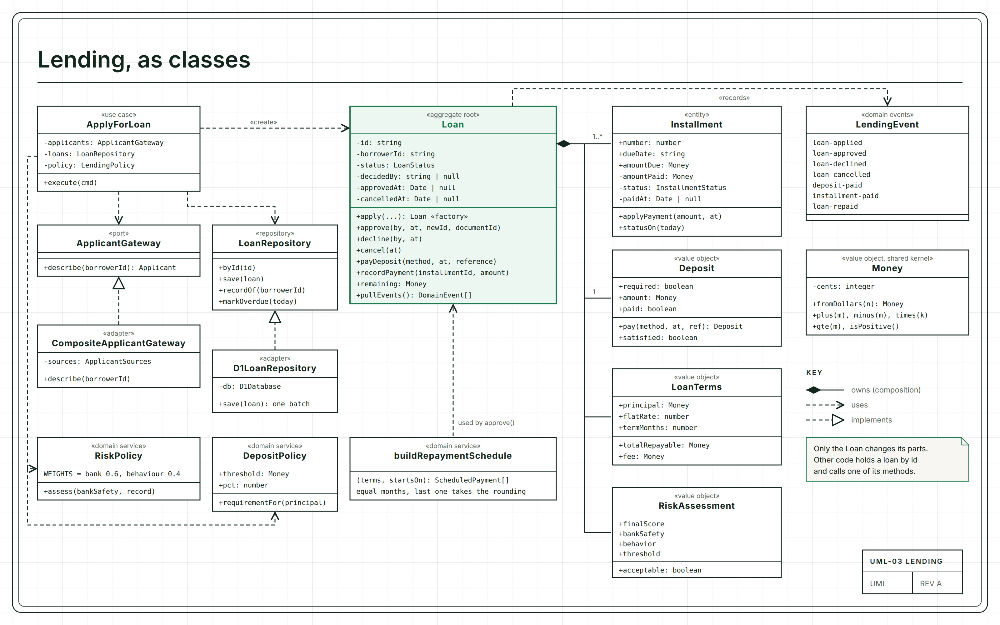</picture></a>
</p>

The class diagram shows the same model in more detail. The **Loan** is the aggregate root. It owns its installments, which are entities, and three value objects: `Deposit`, `LoanTerms` and `RiskAssessment`. Only the Loan changes its parts. Other code holds a loan by its id and calls one of its methods: `apply`, `approve`, `decline`, `cancel`, `payDeposit` or `recordPayment`. Each method checks its rules and records a domain event. The use cases depend on two ports, `ApplicantGateway` and `LoanRepository`. The adapters on the left implement them, so the domain never depends on D1.

<p align="center">
  <a href="docs/images/uml-seq-apply.png"><picture><source media="(prefers-color-scheme: dark)" srcset="docs/images/uml-seq-apply-dark.png">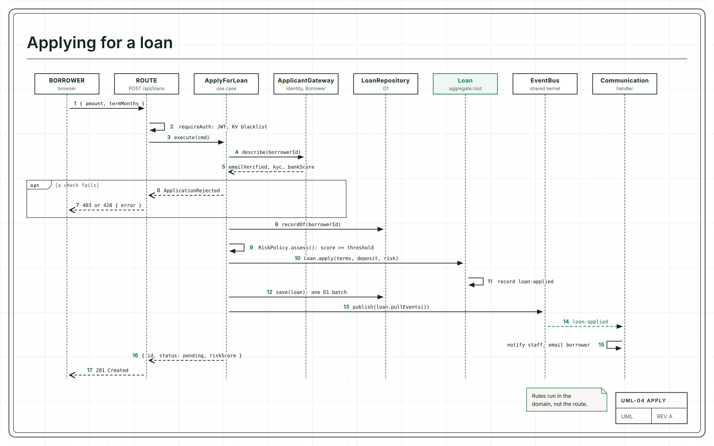</picture></a>
</p>

The sequence diagram follows one application from the browser to the database. The route checks the token and calls the use case. `ApplyForLoan` asks the `ApplicantGateway` for three facts: a verified email, an approved identity check and a bank safety score. If one of them is missing, the use case stops with a named error, and the route answers `403` or `428`. Next, `RiskPolicy` calculates a score: 60 % from the bank safety score and 40 % from the borrowing record. The score must reach `RISK_SCORE_THRESHOLD`. A loan above `LOAN_UPFRONT_THRESHOLD` must also pay a deposit of `LOAN_UPFRONT_PCT` before approval. Then `Loan.apply` creates the loan, the repository saves it, and the event bus tells Communication to alert the staff and email the borrower.

## Feature: approving a loan

<p align="center">
  <a href="docs/images/uml-seq-approve.png"><picture><source media="(prefers-color-scheme: dark)" srcset="docs/images/uml-seq-approve-dark.png">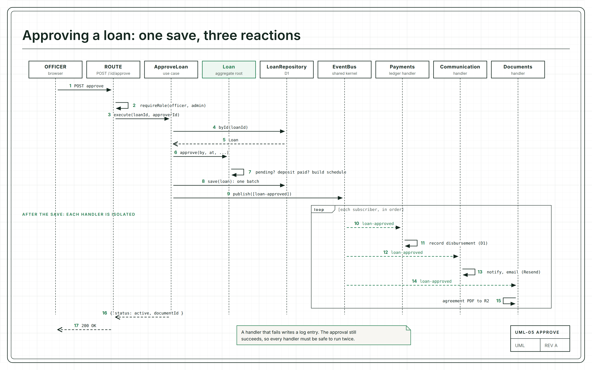</picture></a>
</p>

Approval shows why domain events matter. The officer's request needs the officer or admin role. `ApproveLoan` loads the Loan and calls `approve`. The Loan refuses unless it is pending and any deposit is paid. Then it builds the repayment schedule: equal monthly payments, each due on the same day of the month, or on the last day of a short month. The last payment takes the rounding, so the total is exact to the cent.

After the save, one event, `loan-approved`, starts three reactions. Payments writes a disbursement entry to the ledger. Communication notifies the borrower and sends an email through Resend. Documents renders the loan agreement as a PDF and stores it in R2. Lending knows none of this: it only records the event. Each handler is isolated. If a handler fails, it writes a log entry and the approval still succeeds. So the effects are eventually consistent, and each handler must be safe to run twice.

## Feature: paying an installment

<p align="center">
  <a href="docs/images/cf-payments-3d.png"><picture><source media="(prefers-color-scheme: dark)" srcset="docs/images/cf-payments-3d-dark.png"></picture></a>
</p>

The Payments context takes money in through PayPal. The blueprint shows its layers. The use cases sit on the left, the ports and the settlement check in the middle, and the PayPal and D1 adapters on the right. Payments speaks to Lending only through its own ports, in its own words: `DepositQuotes`, `InstallmentQuotes` and `DepositCollector`.

<p align="center">
  <a href="docs/images/uml-seq-pay.png"><picture><source media="(prefers-color-scheme: dark)" srcset="docs/images/uml-seq-pay-dark.png">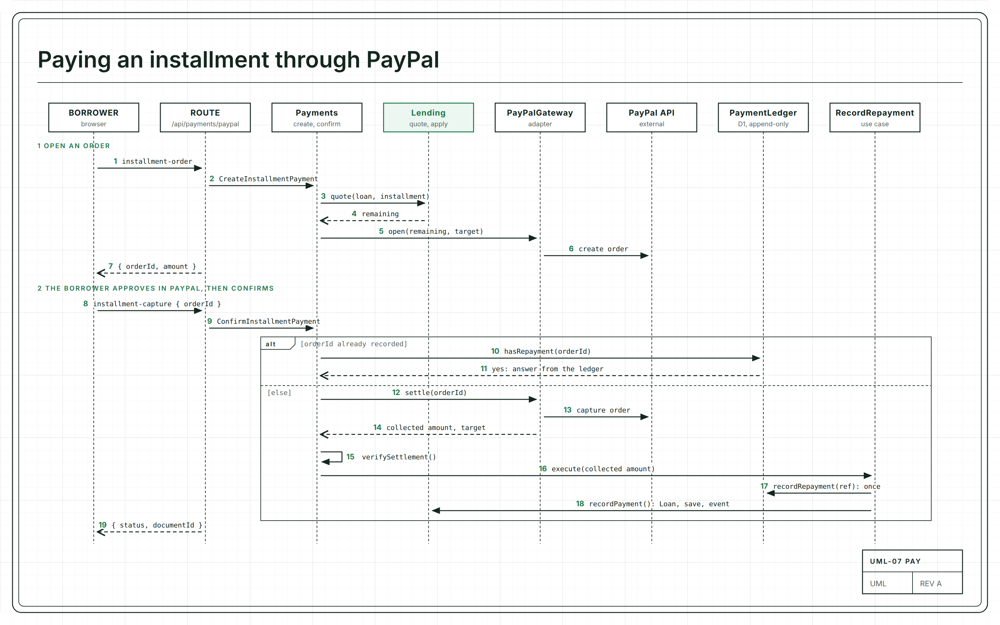</picture></a>
</p>

A payment has two steps, and the borrower never sets the amount. In the first step, Payments asks Lending what is left on the installment. Then it opens a PayPal order for exactly that amount. The order carries its target: the loan, the user and the installment. In the second step, after the borrower approves the order in PayPal, the browser asks Payments to confirm it.

Confirmation is where the safety checks run. A PayPal capture can run only once, so Payments first looks for the order in the ledger. If the order is there, Payments returns the first result and does not call PayPal again. If it is not, Payments captures the order, and the domain service `verifySettlement` checks two facts. PayPal must report the money as collected, and the order must belong to the same loan, user and installment. Payments then records the amount that PayPal collected, not an amount from the client. `RecordRepayment` writes the ledger entry once per provider reference and applies the payment to the Loan, which raises `installment-paid`. When the last installment is paid, the Loan becomes `repaid`.

<br>

## What you can learn from this project

These notes answer the questions that a reader of this code is likely to ask. Each answer gives the technical reason and then the business view: what the choice costs, and what it saves.

### Architecture

**Why one Worker, and not microservices?**
Keel has seven bounded contexts, but they run in one Worker. The boundaries are in the code, and a test enforces them, so nothing needs a network between the contexts. There is one deploy, one log and one place to debug. For the business, every extra service means another deploy pipeline, another set of alerts and another failure mode. For a small team this cost is high and the benefit is low. If one context ever needs to scale alone, it can leave the Worker, because it already talks to the others only through ports and events.

**Why Domain-Driven Design for a small app?**
The lending rules are the part of the system that changes most, and they are the costliest to get wrong. DDD keeps them in one place, in plain TypeScript, and tests them in milliseconds without a database. The price is more files and more indirection at the start. A simple CRUD app would not repay it. For the business, the payoff is that a new rule, such as a different deposit threshold, changes one method and not five routes.

**Why ports and adapters?**
Each context declares what it needs, in its own words, as an interface. An adapter in the infrastructure layer then supplies it. So the domain never imports D1, PayPal or another context. This also limits lock-in: all Cloudflare-specific and provider-specific code sits in one layer, so a move to another database or payment provider touches adapters, not rules.

### Cloud and cost

**Why Cloudflare Workers, and not containers or virtual machines?**
A Worker starts in milliseconds, runs near the user and needs no server patching. There is no idle machine, so the bill follows use: requests, database reads and writes, and stored bytes. Check Cloudflare's pricing page for current numbers. The trade-offs are real. A Worker lives for one request, so there are no background consumers, and the platform ties the project to Cloudflare's bindings. The adapters limit that second cost.

**Why D1 (SQLite) and not Postgres?**
Loans, installments and the ledger are relational data that needs constraints and atomic writes. D1 gives this as a managed service, and a D1 batch saves a loan and its installments together or not at all. There is no database server to run, size or back up. The limit is scale: one D1 database fits this project, but heavy write load or multi-region writes would need another design. The README lists scale as out of scope on purpose.

**Why KV and R2 as well?**
Each store does one job well. KV is fast for small keys that expire: the logout blacklist, a throttle for verification emails and dedup keys for webhooks. R2 stores the PDF files cheaply and sends no egress fees. D1 would work for both, but it would carry data that does not need SQL. Using the right store keeps the database small and the bill low.

### Code quality

**Why no ORM?**
The repositories use plain SQL with bound parameters. The domain model does not match the tables. For example, the `loans` table stores declined and cancelled loans as `defaulted`, and only the repository knows this. An ORM would still need a mapper, and it adds weight to the Worker bundle. Plain SQL keeps the mapping in one visible place.

**Why store money in whole cents?**
Floating-point numbers cannot hold 0.1 exactly, and small errors add up across a schedule. The `Money` value object keeps whole cents, and the schedule gives the rounding to the last installment, so the total is exact. For the business, a one-cent error in a ledger is an audit problem. One honest flaw: the D1 columns hold dollars as `REAL`, and the repository converts at the boundary. Integer cents in the database would be cleaner, and the schema would need a migration to get there.

**How do you test a Worker?**
Vitest runs inside the real Workers runtime (Miniflare), with real D1, KV and R2 bindings, not mocks. The domain rules have pure tests with no database. An architecture test fails when a layer breaks the dependency rule. For the business, this gives fast feedback and catches structure problems before they reach a reviewer.

### Safety and money

**How does the system avoid taking a payment twice?**
Four layers work together. The ledger has a unique index on the provider reference, so it records each payment once. A PayPal capture runs only once, so a repeat gets its answer from the ledger. Payments records the amount PayPal collected, not an amount from the browser. The Didit webhook carries an HMAC signature and a dedup key in KV, so a repeated or forged call does nothing. A duplicate charge is among the most expensive bugs a lender can ship.

**How does Keel protect passwords and personal data?**
Passwords use PBKDF2 with 100,000 iterations and SHA-256, through the Web Crypto API that every Worker has. The profile fields and the Plaid access token use AES-GCM, so the database holds only ciphertext. Sessions use signed tokens, and a logout puts the token on a KV blacklist. Turnstile checks register and log in, and it fails closed. For the business, encryption at rest limits the damage of a leak.

### Looking ahead

**What would change first at a larger scale?**
Four things, in this order. First, Cloudflare Queues for domain events, for durability and retries. Second, integer cents in the database. Third, the `audit_logs` table has no writer yet, so something should write to it. Fourth, a process that sets the `defaulted` status, and a collections flow. The business rule behind this list: build each item when the risk it covers becomes real, not before. Each item costs time and adds moving parts.

**What does the frontend show?**
Keel's interface has a living design-system page at `/system`, with every colour token and component. Each animation has a reduced-motion path. The wording is plain, and each step in the application flow has one clear action. For the business, a consistent interface is cheaper to extend, and clear steps reduce the support questions that a lender gets.

<br>

## Developer guide

<details>
<summary><b>Stack and local URLs</b></summary>

| Layer | Tech | Local URL |
|-------|------|-----------|
| API | Cloudflare Worker (Hono + TypeScript) | http://localhost:8787 |
| Frontend | React + Vite SPA | http://localhost:5173 |
| Database | Cloudflare D1 (SQLite) | local via Wrangler |
| Cache | Cloudflare KV | local via Wrangler |
| Documents | Cloudflare R2 | local via Wrangler |

OpenAPI spec: [`api/openapi.json`](./api/openapi.json) — served at `/openapi.json` and documented at `/docs` when the worker is running.

</details>

<details>
<summary><b>Prerequisites</b></summary>

- **Node.js 20+**
- **npm**
- **Wrangler CLI** (`npm install` at repo root installs it)
- **Cloudflare account** (for production deploy)
- Third-party keys as needed: Plaid (sandbox), Didit, Stripe/PayPal (payments), Turnstile

</details>

<details>
<summary><b>Development setup</b></summary>

### 1. Install dependencies

```bash
npm install
npm install --prefix frontend
npm install --prefix api
```

### Didit KYC setup

1. Set `DIDIT_API_KEY`, `DIDIT_WORKFLOW_ID`, `DIDIT_WEBHOOK_SECRET`, and `DIDIT_SESSION_CREATE_URL` in `.env`.
2. Register a webhook destination in the [Didit console](https://business.didit.me) pointing to `https://<your-worker>.workers.dev/api/webhooks/didit` with events `status.updated` and `data.updated`.

Flow: `POST /api/kyc/session` (server) → frontend opens Didit modal with returned `url` → Didit POSTs signed webhook → profile `kyc_status` updates.

### 2. Configure environment (local)

Create **`.env`** in the **repo root** (see [`.env.example`](./.env.example)). Wrangler, Vitest, and Vite all read this file locally. **Never commit `.env`.**

```bash
# Auth & security
JWT_SECRET=local-dev-jwt-secret-change-me
TURNSTILE_SECRET=1x0000000000000000000000000000000AA
PII_ENCRYPTION_KEY=<base64-encoded-32-byte-AES-key>

# Didit
DIDIT_API_KEY=your-didit-api-key
DIDIT_WORKFLOW_ID=your-workflow-id
DIDIT_WEBHOOK_SECRET=your-webhook-signing-secret
DIDIT_SESSION_CREATE_URL=https://verification.didit.me/v3/session/

# Plaid
PLAID_CLIENT_ID=your-plaid-client-id
PLAID_SECRET=your-plaid-secret
PLAID_BASE_URL=https://sandbox.plaid.com
PLAID_SANDBOX_INSTITUTION=ins_109508

# Payments
STRIPE_SECRET_KEY=sk_test_...
STRIPE_PUBLISHABLE_KEY=pk_test_...
PAYPAL_CLIENT_ID=your-paypal-client-id
PAYPAL_SECRET=your-paypal-secret

# Loan / risk tuning
LOAN_FLAT_INTEREST_RATE=0.05
LOAN_UPFRONT_THRESHOLD=5000
LOAN_UPFRONT_PCT=0.05
RISK_SCORE_THRESHOLD=50

# Frontend (Vite reads VITE_* from the same .env)
VITE_TURNSTILE_TOKEN=XXXX.DUMMY.TOKEN.XXXX
```

Generate a PII encryption key:

```bash
node -e "console.log(require('crypto').randomBytes(32).toString('base64'))"
```

`TURNSTILE_SECRET=1x0000000000000000000000000000000AA` is Cloudflare's **always-pass test secret** — fine for local dev.

### 3. Apply database migrations (local D1)

```bash
npx wrangler d1 migrations apply microloans_db --local
```

Run this after pulling new migrations or when resetting local state.

### 4. Start the API

```bash
npm run dev
# Equivalent: npx wrangler dev
```

Worker ready at **http://localhost:8787**.

```bash
curl -s http://localhost:8787/api/health
curl -s http://localhost:8787/docs        # API documentation UI
curl -s http://localhost:8787/openapi.json
```

### 5. Start the frontend (separate terminal)

```bash
npm run frontend:dev
# Equivalent: npm run dev --prefix frontend
```

Open **http://localhost:5173**. Vite proxies `/api/*` to the worker on port 8787.

</details>

<details>
<summary><b>Production build and deploy</b></summary>

Deployment is split: the **Worker** serves the API; the **frontend** is built as static assets and deployed separately (Cloudflare Pages or Workers Assets).

### 1. Cloudflare resources

Ensure `wrangler.toml` bindings match your account:

- D1 database `microloans_db`
- KV namespace `LOAN_CACHE`
- R2 bucket `microloans-documents`

Create missing resources if needed:

```bash
npx wrangler d1 create microloans_db
npx wrangler kv namespace create LOAN_CACHE
npx wrangler r2 bucket create microloans-documents
```

Update `database_id` / KV `id` in `wrangler.toml` with the values Wrangler prints.

### 2. Set production secrets

From the repo root, upload every Worker binding from `.env` in one shot:

```bash
npm run secrets:push
```

This runs `scripts/push-wrangler-secrets.sh`, which reads each key from `.env` and pipes it to `wrangler secret put`. Empty PayPal keys are skipped; all other keys must be set. Frontend-only `VITE_*` vars are not uploaded to the Worker.

Use real Turnstile and Plaid production credentials in prod (not the test values).

### 3. Apply migrations (remote D1)

```bash
npx wrangler d1 migrations apply microloans_db --remote
```

### 4. Deploy the API Worker

```bash
npm run deploy
# Builds frontend (for future asset bundling) then: wrangler deploy
```

Or deploy API only:

```bash
npx wrangler deploy
```

Note the deployed worker URL (e.g. `https://microloans-platform.<account>.workers.dev`).

### 5. Deploy the frontend

Build the SPA:

```bash
npm run frontend:build
# Output: frontend/dist/
```

Deploy `frontend/dist/` to **Cloudflare Pages** (or attach as Workers Assets). Set the Pages **environment variable** or build-time config so API calls reach your worker URL. In local dev the Vite proxy handles this; in production configure your hosting to route `/api` to the worker or set the API base URL in the frontend client.

</details>

<details>
<summary><b>Web UI flows</b></summary>

The frontend is **Keel**, rebuilt from scratch (design spec: `tasks/keel-design-spec.md`, plans in `tasks/todo.md`). Set `DEMO_MODE=true` in `.dev.vars` to show demo buttons (fill forms, mark bank/ID done, approve your own loan).

| Route | Who | What |
|-------|-----|------|
| `/` | Public | Landing page: parallax hero, how it works, repayment calculator |
| `/signin` | Public | Sign in (Turnstile token from `VITE_TURNSTILE_TOKEN`) |
| `/signup` | Public | Create an account, then signs in |
| `/app/loans` | Borrower | Dashboard: next payment, payment strip, totals, upcoming, activity |
| `/app/apply` | Borrower | Amount/term sliders with live quote (`?amount=` presets) |
| `/app/loans/:id` | Borrower, officer | Progress steps, schedule, deposit, demo payments, cancel while pending, documents |
| `/app/setup` | Borrower | Details, bank (Plaid), ID (Didit) |
| `/app/queue` | Officer / Admin | Review queue: summary, risk, approve / decline |
| `/system` | Public | Living design-system reference: tokens and components |

</details>

<details>
<summary><b>API examples (curl)</b></summary>

Use the always-pass Turnstile token in dev: `"turnstileToken": "XXXX.DUMMY.TOKEN.XXXX"`.

```bash
BASE=http://localhost:8787/api

# Register
curl -s -X POST "$BASE/auth/register" \
  -H 'Content-Type: application/json' \
  -d '{
    "email": "borrower@example.com",
    "password": "SecurePass123!",
    "turnstileToken": "XXXX.DUMMY.TOKEN.XXXX"
  }'

# Login → save token
TOKEN=$(curl -s -X POST "$BASE/auth/login" \
  -H 'Content-Type: application/json' \
  -d '{
    "email": "borrower@example.com",
    "password": "SecurePass123!",
    "turnstileToken": "XXXX.DUMMY.TOKEN.XXXX"
  }' | jq -r .token)

AUTH="Authorization: Bearer $TOKEN"

# Current user
curl -s "$BASE/auth/me" -H "$AUTH"

# Start Didit KYC session
curl -s -X POST "$BASE/kyc/session" -H "$AUTH"

# Plaid link token
curl -s -X POST "$BASE/plaid/link-token" -H "$AUTH"

# Create a loan (requires KYC + bank score — may return 428/403 until prerequisites met)
curl -s -X POST "$BASE/loans" \
  -H "$AUTH" -H 'Content-Type: application/json' \
  -d '{"amount": 500, "term_months": 6}'

# List loans
curl -s "$BASE/loans" -H "$AUTH"

# Officer: approve (requires officer/admin JWT)
curl -s -X POST "$BASE/loans/{loanId}/approve" -H "Authorization: Bearer $OFFICER_TOKEN"
```

Authenticated routes expect `Authorization: Bearer <jwt>`. JWTs expire after 1 hour.

</details>

<details>
<summary><b>Key API routes</b></summary>

| Method | Path | Auth | Description |
|--------|------|------|-------------|
| GET | `/api/health` | — | Health check |
| POST | `/api/auth/register` | — | Create borrower account |
| POST | `/api/auth/login` | — | Issue JWT |
| GET | `/api/auth/me` | JWT | Current user |
| POST | `/api/kyc/session` | JWT | Create Didit verification session |
| POST | `/api/plaid/link-token` | JWT | Plaid Link token |
| POST | `/api/plaid/connect` | JWT | Exchange public token, compute bank score |
| GET/POST | `/api/loans` | JWT | List / create loans |
| POST | `/api/loans/{id}/approve` | officer | Activate loan + schedule |
| POST | `/api/loans/{id}/reject` | officer | Reject application |
| POST | `/api/loans/{id}/installments/{id}/pay` | JWT | Record repayment |
| GET | `/api/profile` | JWT | Borrower profile (PII decrypted) |
| GET | `/api/config` | — | Public Stripe/PayPal client keys |
| GET | `/api/documents` | JWT | List generated PDFs |

Full contract: [`api/openapi.json`](./api/openapi.json).

</details>

<details>
<summary><b>Testing</b></summary>

```bash
# All API tests (Workers runtime via Miniflare)
npm test

# From api/
cd api && npx vitest run

# Single file
cd api && npx vitest run test/loans.spec.ts

# Single test by name
cd api && npx vitest run -t "creates a pending loan"
```

Tests apply D1 migrations automatically via `api/vitest.config.ts`.

</details>

<details>
<summary><b>Security and design notes</b></summary>

- **PII** in `profiles` is AES-GCM encrypted at rest (`PII_ENCRYPTION_KEY`).
- **Auth** is HS256 JWT (`JWT_SECRET`); middleware in `api/src/middleware/requireAuth.ts`.
- **Roles**: `borrower` (default), `officer`, `admin`.

Deeper design docs:

- [`docs/design-system.md`](docs/design-system.md) — how the drawings above are made
- [`CLOUDFLARE_MICROLOAN_PLAN.md`](./CLOUDFLARE_MICROLOAN_PLAN.md) — original architecture
- [`.claude/CLAUDE.md`](./.claude/CLAUDE.md) — developer reference

</details>

<details>
<summary><b>npm scripts (repo root)</b></summary>

| Script | Action |
|--------|--------|
| `npm run dev` | Start Worker (`wrangler dev`) |
| `npm run frontend:dev` | Start Vite dev server |
| `npm run frontend:build` | Production SPA build |
| `npm test` | Run API test suite |
| `npm run deploy` | Build frontend + `wrangler deploy` |
| `npm run secrets:push` | Upload all Worker secrets from `.env` via Wrangler |

</details>

<details>
<summary><b>Troubleshooting</b></summary>

**`wrangler dev` fails on bindings** — Run migrations locally: `npx wrangler d1 migrations apply microloans_db --local`.

**Frontend API calls fail with connection refused** — Ensure the worker is running on **8787** before starting Vite.

**Loan creation returns 428 or 403** — Complete KYC and Plaid bank connection first; the API gates loan creation on verified identity and bank safety score.

**Plaid errors in dev** — Confirm `PLAID_CLIENT_ID` and `PLAID_SECRET` in `.dev.vars` are valid sandbox credentials.

</details>
