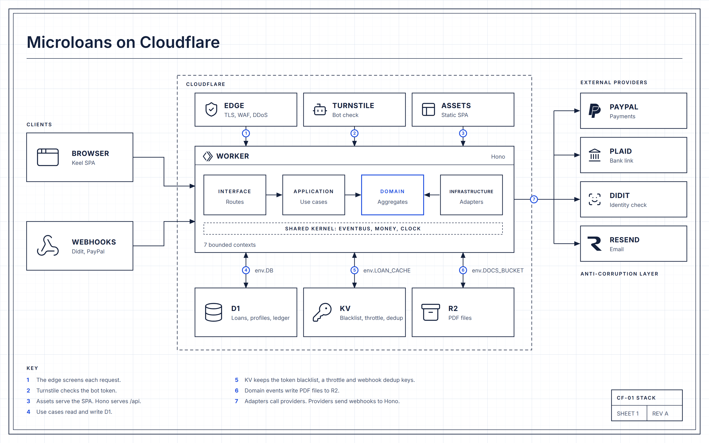
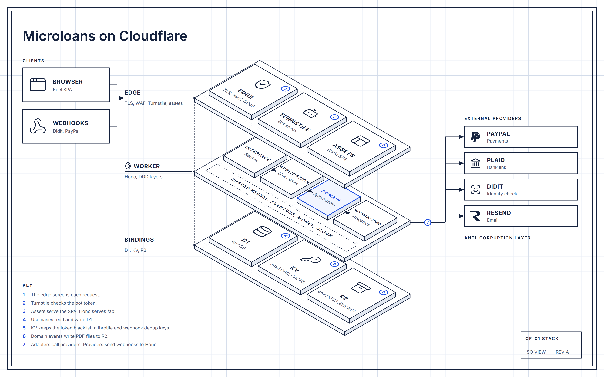
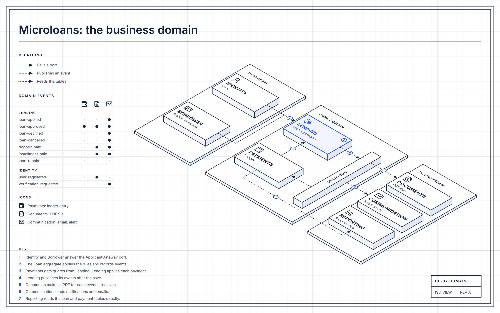
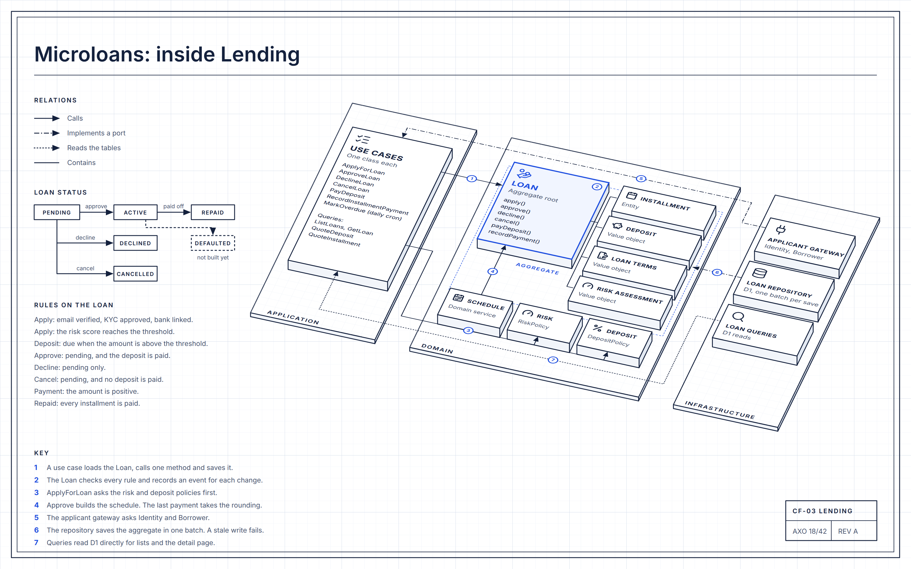
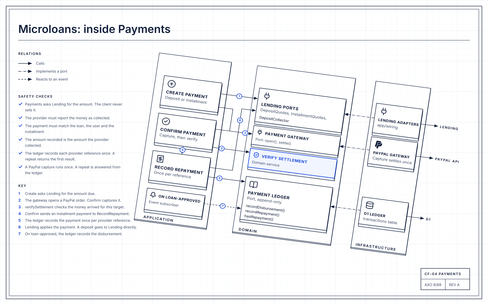

<a href="docs/design-system.md"></a>

<p align="center">
  <a href="https://developers.cloudflare.com/workers/"></a>
  <a href="https://developers.cloudflare.com/d1/"></a>
  <a href="https://hono.dev"></a>
  <a href="https://www.typescriptlang.org"></a>
  <a href="#the-business-domain"></a>
  <a href="https://vitest.dev"></a>
  <a href="docs/design-system.md"></a>
</p>

<br>

Borrowers apply for a small loan, verify their identity, link a bank account and repay in monthly installments. Loan officers review each application and approve or decline it. The whole platform runs on one Cloudflare Worker. The business rules live in a domain model, split into seven bounded contexts that talk through domain events.

Every drawing below comes from the code. Each sheet is a short Python script in [`docs/images/`](docs/images/), and [`docs/design-system.md`](docs/design-system.md) holds the rules they follow.

<br>

### The stack

<p align="center">
  <a href="docs/images/cf-stack.png"></a>
  <a href="docs/images/cf-stack-3d.png"></a>
</p>

- **One Worker, one deploy.** The Worker serves the Hono API and the built frontend (static assets with an SPA fallback). There is no server to run or patch.
- **Bindings, not connection strings.** D1 holds the relational data. KV keeps the token blacklist, a resend throttle and webhook dedup keys. R2 stores the generated PDFs. Each one is a binding in [`wrangler.toml`](wrangler.toml).
- **Guards at the edge.** Turnstile checks register and log in. A cron trigger marks overdue installments every day at 06:00 UTC.
- **Providers stay outside.** PayPal, Plaid, Didit and Resend sit behind adapters. Provider JSON never leaves the infrastructure layer.

### The business domain

<p align="center">
  <a href="docs/images/cf-domain-3d.png"></a>
</p>

- **Lending is the core.** It asks Identity and Borrower one question through its own port, `ApplicantGateway`, and never sees how they store anything.
- **Contexts react to events.** Lending and Identity raise nine kinds of event. Payments, Documents and Communication subscribe. A failing handler is logged and never fails the command, so the effects are eventually consistent and every handler is idempotent.
- **The dependency rule is tested.** [`api/test/architecture.spec.ts`](api/test/architecture.spec.ts) fails if a domain imports Hono or D1, or if one context reaches into another's infrastructure.

### Inside Lending

<p align="center">
  <a href="docs/images/cf-lending-3d.png"></a>
</p>

- **Rules live on the aggregate.** `loan.approve()` refuses unless the loan is pending and any deposit is paid. `loan.cancel()` refuses once a deposit is paid. Use cases only load, call and save.
- **One save, one batch.** The repository writes the loan and its installments in one D1 batch. A stale write fails instead of overwriting newer data.
- **Exact money.** Amounts are whole cents. The repayment schedule gives the rounding to the last installment, so the total is exact.

### Inside Payments

<p align="center">
  <a href="docs/images/cf-payments-3d.png"></a>
</p>

- **The client never sets the amount.** Payments asks Lending what is due, opens a PayPal order for exactly that, and records what PayPal actually collected.
- **Verify before use.** `verifySettlement` checks that the money arrived and that the order belongs to this loan, this user and this installment.
- **Once per reference.** The ledger is append-only and records each provider reference at most once. A repeated confirm returns the first result.

<br>

## Developer guide

<details>
<summary><b>Stack and local URLs</b></summary>

| Layer | Tech | Local URL |
|-------|------|-----------|
| API | Cloudflare Worker (Hono + TypeScript) | http://localhost:8787 |
| Frontend | React + Vite SPA | http://localhost:5173 |
| Database | Cloudflare D1 (SQLite) | local via Wrangler |
| Cache | Cloudflare KV | local via Wrangler |
| Documents | Cloudflare R2 | local via Wrangler |

OpenAPI spec: [`api/openapi.json`](./api/openapi.json) — served at `/openapi.json` and documented at `/docs` when the worker is running.

</details>

<details>
<summary><b>Prerequisites</b></summary>

- **Node.js 20+**
- **npm**
- **Wrangler CLI** (`npm install` at repo root installs it)
- **Cloudflare account** (for production deploy)
- Third-party keys as needed: Plaid (sandbox), Didit, Stripe/PayPal (payments), Turnstile

</details>

<details>
<summary><b>Development setup</b></summary>

### 1. Install dependencies

```bash
npm install
npm install --prefix frontend
npm install --prefix api
```

### Didit KYC setup

1. Set `DIDIT_API_KEY`, `DIDIT_WORKFLOW_ID`, `DIDIT_WEBHOOK_SECRET`, and `DIDIT_SESSION_CREATE_URL` in `.env`.
2. Register a webhook destination in the [Didit console](https://business.didit.me) pointing to `https://<your-worker>.workers.dev/api/webhooks/didit` with events `status.updated` and `data.updated`.

Flow: `POST /api/kyc/session` (server) → frontend opens Didit modal with returned `url` → Didit POSTs signed webhook → profile `kyc_status` updates.

### 2. Configure environment (local)

Create **`.env`** in the **repo root** (see [`.env.example`](./.env.example)). Wrangler, Vitest, and Vite all read this file locally. **Never commit `.env`.**

```bash
# Auth & security
JWT_SECRET=local-dev-jwt-secret-change-me
TURNSTILE_SECRET=1x0000000000000000000000000000000AA
PII_ENCRYPTION_KEY=<base64-encoded-32-byte-AES-key>

# Didit
DIDIT_API_KEY=your-didit-api-key
DIDIT_WORKFLOW_ID=your-workflow-id
DIDIT_WEBHOOK_SECRET=your-webhook-signing-secret
DIDIT_SESSION_CREATE_URL=https://verification.didit.me/v3/session/

# Plaid
PLAID_CLIENT_ID=your-plaid-client-id
PLAID_SECRET=your-plaid-secret
PLAID_BASE_URL=https://sandbox.plaid.com
PLAID_SANDBOX_INSTITUTION=ins_109508

# Payments
STRIPE_SECRET_KEY=sk_test_...
STRIPE_PUBLISHABLE_KEY=pk_test_...
PAYPAL_CLIENT_ID=your-paypal-client-id
PAYPAL_SECRET=your-paypal-secret

# Loan / risk tuning
LOAN_FLAT_INTEREST_RATE=0.05
LOAN_UPFRONT_THRESHOLD=5000
LOAN_UPFRONT_PCT=0.05
RISK_SCORE_THRESHOLD=50

# Frontend (Vite reads VITE_* from the same .env)
VITE_TURNSTILE_TOKEN=XXXX.DUMMY.TOKEN.XXXX
```

Generate a PII encryption key:

```bash
node -e "console.log(require('crypto').randomBytes(32).toString('base64'))"
```

`TURNSTILE_SECRET=1x0000000000000000000000000000000AA` is Cloudflare's **always-pass test secret** — fine for local dev.

### 3. Apply database migrations (local D1)

```bash
npx wrangler d1 migrations apply microloans_db --local
```

Run this after pulling new migrations or when resetting local state.

### 4. Start the API

```bash
npm run dev
# Equivalent: npx wrangler dev
```

Worker ready at **http://localhost:8787**.

```bash
curl -s http://localhost:8787/api/health
curl -s http://localhost:8787/docs        # API documentation UI
curl -s http://localhost:8787/openapi.json
```

### 5. Start the frontend (separate terminal)

```bash
npm run frontend:dev
# Equivalent: npm run dev --prefix frontend
```

Open **http://localhost:5173**. Vite proxies `/api/*` to the worker on port 8787.

</details>

<details>
<summary><b>Production build and deploy</b></summary>

Deployment is split: the **Worker** serves the API; the **frontend** is built as static assets and deployed separately (Cloudflare Pages or Workers Assets).

### 1. Cloudflare resources

Ensure `wrangler.toml` bindings match your account:

- D1 database `microloans_db`
- KV namespace `LOAN_CACHE`
- R2 bucket `microloans-documents`

Create missing resources if needed:

```bash
npx wrangler d1 create microloans_db
npx wrangler kv namespace create LOAN_CACHE
npx wrangler r2 bucket create microloans-documents
```

Update `database_id` / KV `id` in `wrangler.toml` with the values Wrangler prints.

### 2. Set production secrets

From the repo root, upload every Worker binding from `.env` in one shot:

```bash
npm run secrets:push
```

This runs `scripts/push-wrangler-secrets.sh`, which reads each key from `.env` and pipes it to `wrangler secret put`. Empty PayPal keys are skipped; all other keys must be set. Frontend-only `VITE_*` vars are not uploaded to the Worker.

Use real Turnstile and Plaid production credentials in prod (not the test values).

### 3. Apply migrations (remote D1)

```bash
npx wrangler d1 migrations apply microloans_db --remote
```

### 4. Deploy the API Worker

```bash
npm run deploy
# Builds frontend (for future asset bundling) then: wrangler deploy
```

Or deploy API only:

```bash
npx wrangler deploy
```

Note the deployed worker URL (e.g. `https://microloans-platform.<account>.workers.dev`).

### 5. Deploy the frontend

Build the SPA:

```bash
npm run frontend:build
# Output: frontend/dist/
```

Deploy `frontend/dist/` to **Cloudflare Pages** (or attach as Workers Assets). Set the Pages **environment variable** or build-time config so API calls reach your worker URL. In local dev the Vite proxy handles this; in production configure your hosting to route `/api` to the worker or set the API base URL in the frontend client.

</details>

<details>
<summary><b>Web UI flows</b></summary>

The frontend is **Keel**, rebuilt from scratch (design spec: `tasks/keel-design-spec.md`, plans in `tasks/todo.md`). Set `DEMO_MODE=true` in `.dev.vars` to show demo buttons (fill forms, mark bank/ID done, approve your own loan).

| Route | Who | What |
|-------|-----|------|
| `/` | Public | Landing page: parallax hero, how it works, repayment calculator |
| `/signin` | Public | Sign in (Turnstile token from `VITE_TURNSTILE_TOKEN`) |
| `/signup` | Public | Create an account, then signs in |
| `/app/loans` | Borrower | Dashboard: next payment, payment strip, totals, upcoming, activity |
| `/app/apply` | Borrower | Amount/term sliders with live quote (`?amount=` presets) |
| `/app/loans/:id` | Borrower, officer | Progress steps, schedule, deposit, demo payments, cancel while pending, documents |
| `/app/setup` | Borrower | Details, bank (Plaid), ID (Didit) |
| `/app/queue` | Officer / Admin | Review queue: summary, risk, approve / decline |
| `/system` | Public | Living design-system reference: tokens and components |

</details>

<details>
<summary><b>API examples (curl)</b></summary>

Use the always-pass Turnstile token in dev: `"turnstileToken": "XXXX.DUMMY.TOKEN.XXXX"`.

```bash
BASE=http://localhost:8787/api

# Register
curl -s -X POST "$BASE/auth/register" \
  -H 'Content-Type: application/json' \
  -d '{
    "email": "borrower@example.com",
    "password": "SecurePass123!",
    "turnstileToken": "XXXX.DUMMY.TOKEN.XXXX"
  }'

# Login → save token
TOKEN=$(curl -s -X POST "$BASE/auth/login" \
  -H 'Content-Type: application/json' \
  -d '{
    "email": "borrower@example.com",
    "password": "SecurePass123!",
    "turnstileToken": "XXXX.DUMMY.TOKEN.XXXX"
  }' | jq -r .token)

AUTH="Authorization: Bearer $TOKEN"

# Current user
curl -s "$BASE/auth/me" -H "$AUTH"

# Start Didit KYC session
curl -s -X POST "$BASE/kyc/session" -H "$AUTH"

# Plaid link token
curl -s -X POST "$BASE/plaid/link-token" -H "$AUTH"

# Create a loan (requires KYC + bank score — may return 428/403 until prerequisites met)
curl -s -X POST "$BASE/loans" \
  -H "$AUTH" -H 'Content-Type: application/json' \
  -d '{"amount": 500, "term_months": 6}'

# List loans
curl -s "$BASE/loans" -H "$AUTH"

# Officer: approve (requires officer/admin JWT)
curl -s -X POST "$BASE/loans/{loanId}/approve" -H "Authorization: Bearer $OFFICER_TOKEN"
```

Authenticated routes expect `Authorization: Bearer <jwt>`. JWTs expire after 1 hour.

</details>

<details>
<summary><b>Key API routes</b></summary>

| Method | Path | Auth | Description |
|--------|------|------|-------------|
| GET | `/api/health` | — | Health check |
| POST | `/api/auth/register` | — | Create borrower account |
| POST | `/api/auth/login` | — | Issue JWT |
| GET | `/api/auth/me` | JWT | Current user |
| POST | `/api/kyc/session` | JWT | Create Didit verification session |
| POST | `/api/plaid/link-token` | JWT | Plaid Link token |
| POST | `/api/plaid/connect` | JWT | Exchange public token, compute bank score |
| GET/POST | `/api/loans` | JWT | List / create loans |
| POST | `/api/loans/{id}/approve` | officer | Activate loan + schedule |
| POST | `/api/loans/{id}/reject` | officer | Reject application |
| POST | `/api/loans/{id}/installments/{id}/pay` | JWT | Record repayment |
| GET | `/api/profile` | JWT | Borrower profile (PII decrypted) |
| GET | `/api/config` | — | Public Stripe/PayPal client keys |
| GET | `/api/documents` | JWT | List generated PDFs |

Full contract: [`api/openapi.json`](./api/openapi.json).

</details>

<details>
<summary><b>Testing</b></summary>

```bash
# All API tests (Workers runtime via Miniflare)
npm test

# From api/
cd api && npx vitest run

# Single file
cd api && npx vitest run test/loans.spec.ts

# Single test by name
cd api && npx vitest run -t "creates a pending loan"
```

Tests apply D1 migrations automatically via `api/vitest.config.ts`.

</details>

<details>
<summary><b>Security and design notes</b></summary>

- **PII** in `profiles` is AES-GCM encrypted at rest (`PII_ENCRYPTION_KEY`).
- **Auth** is HS256 JWT (`JWT_SECRET`); middleware in `api/src/middleware/requireAuth.ts`.
- **Roles**: `borrower` (default), `officer`, `admin`.

Deeper design docs:

- [`docs/design-system.md`](docs/design-system.md) — how the drawings above are made
- [`CLOUDFLARE_MICROLOAN_PLAN.md`](./CLOUDFLARE_MICROLOAN_PLAN.md) — original architecture
- [`.claude/CLAUDE.md`](./.claude/CLAUDE.md) — developer reference

</details>

<details>
<summary><b>npm scripts (repo root)</b></summary>

| Script | Action |
|--------|--------|
| `npm run dev` | Start Worker (`wrangler dev`) |
| `npm run frontend:dev` | Start Vite dev server |
| `npm run frontend:build` | Production SPA build |
| `npm test` | Run API test suite |
| `npm run deploy` | Build frontend + `wrangler deploy` |
| `npm run secrets:push` | Upload all Worker secrets from `.env` via Wrangler |

</details>

<details>
<summary><b>Troubleshooting</b></summary>

**`wrangler dev` fails on bindings** — Run migrations locally: `npx wrangler d1 migrations apply microloans_db --local`.

**Frontend API calls fail with connection refused** — Ensure the worker is running on **8787** before starting Vite.

**Loan creation returns 428 or 403** — Complete KYC and Plaid bank connection first; the API gates loan creation on verified identity and bank safety score.

**Plaid errors in dev** — Confirm `PLAID_CLIENT_ID` and `PLAID_SECRET` in `.dev.vars` are valid sandbox credentials.

</details>
